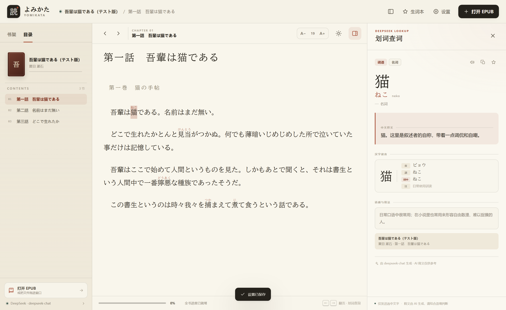

# Yomikata よみかた

一个面向日文小说读者的 EPUB 阅读器：**只查你划取的那一小段文字**，返回中文释义、假名读音、罗马字，以及每个汉字的音读、训读和词中读法。

不会上传整本书，也不会翻译整篇文章。选中一个词，就只发送这个词。


## 功能

- **EPUB 阅读器**：本地 `.epub`，章节目录、阅读进度、上次章节和竖排栏位自动恢复。
- **划词即查**：选中文字后向 DeepSeek 请求释义；拖动期间不弹窗、不发请求，松开并稳定后才处理。
- **词语级解释**：词典形、平假名读音、罗马字、词性、中文释义、语感与用法。
- **逐字读音**：每个汉字的音读、训读，以及它在这个词里的实际读法。
- **句子也能查**：选中短语或整句时，给出该片段的中文意思和关键词。
- **生词本**：星标收藏、搜索、删除，导出 Anki 友好的 CSV。
- **查询历史与缓存**：最近查询可回看，同一个词不重复消耗 API。
- **三种主题**：纸白、茶褐、夜读；字号、行距、字体可调。
- **竖排支持**：自动检测 `vrtl` / `writing-mode: vertical-rl`，保留原书竖排；滚轮、空格、方向键按栏位阅读。
- **图片缩放**：封面和整页插图支持 `Alt + 滚轮` 缩放。
- **隐私优先**：API Key 使用系统加密保存在本机；没有统计、没有遥测、没有云端账号。



## 平台说明

项目最初为 **Windows 10/11** 开发和打包。macOS / Linux 可以从源码运行，但没有做完整发布测试：

- Linux 需要 Node.js 22+、pnpm 和常见的 Electron 运行库（如 `libnss3`、`libatk`、`libgtk-3`、`libsecret-1`）。
- 某些无桌面/容器环境需要给 Electron 加 `--no-sandbox`；普通桌面环境不建议关闭沙箱。
- 系统没有可用的 `libsecret` 时，API Key 会退回本机 base64 存储，并在设置中提示不是系统加密。正式使用建议安装 `libsecret-1-0`。
- Windows 安装包和便携版不放在本源码仓库中。

## 从源码运行

需要 Node.js 22+ 和 pnpm。

```bash
git clone <your-repo-url> yomikata
cd yomikata
pnpm install
pnpm start
```

首次启动后：

1. 打开 [DeepSeek 开放平台](https://platform.deepseek.com/api_keys) 创建 API Key。
2. 进入「设置 → DeepSeek API」，填入 Key。
3. API 地址保持 `https://api.deepseek.com`，模型推荐 `deepseek-chat`。
4. 打开一本无 DRM 的日文 EPUB，在正文里划取词语。

## 开发脚本

```bash
pnpm start        # 开发模式运行
pnpm dev          # 同上，保留开发工具入口
pnpm test:e2e     # 使用本地 mock API 的端到端测试（需要先构建 Windows 包）
pnpm dist         # 构建 Windows NSIS 安装包
pnpm pack         # 构建未打包目录
```

测试文件在 `test/`，其中 `sample.epub` 和 `sample-vertical.epub` 是用公开领域文本制作的测试书。`test/e2e.mjs` 使用本地 mock API，不会消耗真实额度。

## 项目结构

```
electron/
  main.js       Electron 主进程、窗口、文件与 IPC
  preload.js    最小化的 contextBridge API
  store.js      设置与系统加密的 API Key 存储
  deepseek.js   DeepSeek 请求、结构化提示词、JSON 解析
src/
  index.html    应用界面
  styles.css    设计系统与主题
  app.js        EPUB 阅读器、划词、结果渲染、生词本
  vendor/       EPUB.js 与 JSZip（本地打包，离线可用）
test/
  e2e.mjs       本地 mock API 的端到端测试
  sample*.epub  公开领域文本制作的测试书
```

## 隐私与安全

- 只发送你划取的文字；不会上传 EPUB、目录或前后文。
- API Key 通过 Electron `safeStorage` 加密（Windows 为 DPAPI；Linux 为 libsecret，失败时退回本机存储）。
- 渲染 EPUB 时禁用书内脚本，并设置了 CSP。
- 不要把 API Key、`%APPDATA%/Yomikata` 或 `~/.config/Yomikata` 提交到仓库。

## 已知限制

- 不支持带 DRM 的 EPUB。
- AI 释义可能出错；读音和释义请结合语境判断。
- 竖排长章节的选区绘制依赖 Chromium，在超长章节中可能比横排略慢。
- Windows 安装器的旧 NSIS 界面在部分 Windows 11 25H2 环境会卡死；源码运行不受影响。

## License

MIT
